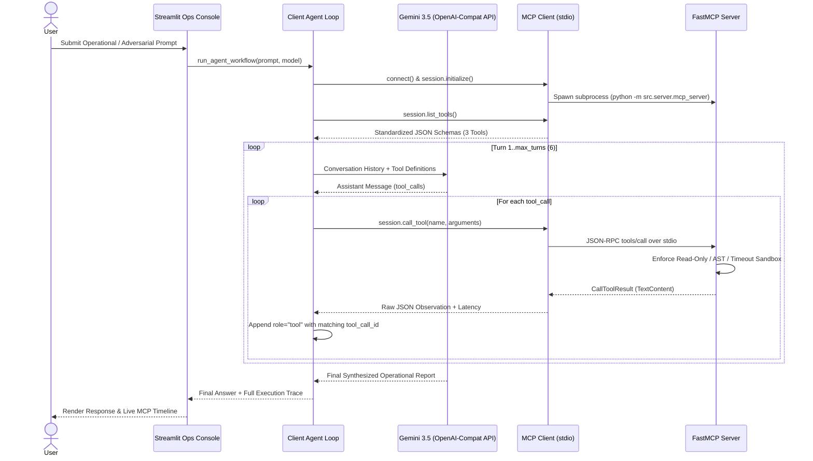

############################# # Autonomous Enterprise Operations Assistant (Model Context Protocol)

An end-to-end, zero-trust tool-augmented AI assistant built with the official Python **Model Context Protocol (MCP)** SDK (`FastMCP` + `ClientSession`) over `stdio` transport, powered by **Gemini 3.5** (`gemini-3.5-flash` / `gemini-3.5-pro`) and an interactive **Streamlit** operations console.

---

## 1. System Architecture & MCP Sequence Diagram

The system decouples model reasoning from tool execution across a strict inter-process `stdio` boundary:

- **MCP Server (`src/server/mcp_server.py`):** Exposes three stateless, sandboxed tools via `FastMCP` over standard input/output (`stdio`).
- **MCP Host Client (`src/client/mcp_client.py`):** Spawns the MCP server subprocess, performs the JSON-RPC handshake (`initialize()`), discovers tool schemas dynamically (`list_tools()`), and translates MCP `inputSchema` payloads into standardized function-calling definitions.
- **Agent Orchestrator (`src/client/agent_loop.py`):** Executes a bounded multi-turn reasoning loop (`max_turns=6`), reconciles `tool_call_id` and `role="tool"` payloads, captures per-step execution latency, and handles errors gracefully without crashing.
- **Interactive Console (`src/app.py`):** Provides real-time visibility into discovered MCP schemas, turn-by-turn tool traces, and a red-team security workbench.



---

## 2. Repository Structure

```text
mcp-agent-tools/
├── pyproject.toml               # uv project configuration & pytest settings
├── .env.example                 # Environment variable template (GEMINI_API_KEY)
├── .gitignore                   # Ignores .venv, .env, __pycache__, .pytest_cache
├── README.md                    # Complete project documentation, audit log & runbook
├── ai_prompt_log.md             # Standalone AI code generation audit log & diffs
├── data/
│   └── enterprise_ops.db        # Seeded SQLite dataset (27 records across 4 tables)
├── src/
│   ├── __init__.py
│   ├── server/
│   │   ├── __init__.py
│   │   ├── mcp_server.py        # FastMCP server exposing 3 tools over stdio
│   │   └── tools/
│   │       ├── __init__.py
│   │       ├── sql_tool.py      # Read-only SQLite executor with sqlparse & mode=ro
│   │       ├── weather_tool.py  # Async Open-Meteo geocoding & forecast client
│   │       └── math_tool.py     # Deterministic Python AST expression evaluator
│   ├── client/
│   │   ├── __init__.py
│   │   ├── mcp_client.py        # Subprocess stdio transport & schema discovery
│   │   └── agent_loop.py        # Multi-turn function-calling orchestrator
│   └── app.py                   # Streamlit interactive console & MCP inspector
└── tests/
    ├── __init__.py
    ├── test_server_tools.py     # Unit tests for SQL, Weather API, and Math tools
    ├── test_mcp_client.py       # Dynamic MCP discovery & chained loop tests
    └── test_security.py         # SQL injection, DDL/DML, and ACE security tests
```

---

## 3. Installation & Prerequisites

### Prerequisites

- **Python:** 3.11+
- **Dependency Manager:** [`uv`](https://docs.astral.sh/uv/)
- **API Key:** Google Gemini API Key (`GEMINI_API_KEY`) — Open-Meteo weather API requires no authentication key.

### Setup Instructions

1. **Clone the repository and install dependencies:**

   ```bash
   git clone [https://github.com/](https://github.com/)your-username/mcp-agent-tools.git
   cd mcp-agent-tools
   uv sync
   ```
2. **Configure environment variables:**

   ```bash
   cp .env.example .env
   ```

   Open `.env` and add your Gemini API key:

   ```env
   GEMINI_API_KEY=your_gemini_api_key_here
   ```
3. **Verify the SQLite dataset (`data/enterprise_ops.db`):**
   The database includes 27 seeded records across `customers`, `products`, `inventory`, and `orders` (including Seattle warehouse inventory for `SKU-90210` and `Order #4492`). If missing, it auto-seeds on server startup or can be initialized manually:

   ```bash
   uv run python -c "from src.server.tools.sql_tool import ensure_database_seeded; ensure_database_seeded()"
   ```

---

## 4. Database Schema & Enterprise Logistics Workflow

The embedded SQLite database (`data/enterprise_ops.db`) models an enterprise supply chain across four relational tables:

- `customers(customer_id, name, tier, city)`
- `products(sku, name, unit_price, weight_kg)`
- `inventory(inventory_id, warehouse_city, sku, quantity_available)`
- `orders(order_id, customer_id, sku, quantity, order_total, destination_city, status)`

### Multi-Tool Operational Query Example

> *"Check if our inventory in Seattle has enough stock of SKU-90210 to fulfill order #4492, verify if rainfall there will delay ground dispatch today, and calculate the total shipping insurance cost at 3.5% of the order value."*

1. **Turn 1 (`query_database`):** Retrieves Order `#4492` (`12` units of `SKU-90210`, order total `$15,000.00`) and Seattle inventory (`42` units available -> sufficient stock).
2. **Turn 2 (`get_current_weather`):** Queries Open-Meteo for Seattle coordinates and evaluates precipitation/wind thresholds (`NORMAL_DISPATCH`, `MODERATE_WET_ROAD_CAUTION`, or `HIGH_DELAY_RISK`).
3. **Turn 3 (`calculate_expression`):** Computes `15000 * 0.035` deterministically via Python AST (`$525.00`).
4. **Turn 4 (Final Response):** Synthesizes all three tool observations into an executive operational summary.

---

## 5. Tool Specifications & Zero-Trust Security Boundaries

### Tool 1: `query_database(sql_query: str) -> str`

- **Purpose:** Executes read-only analytical queries against `data/enterprise_ops.db`.
- **Zero-Trust Security Controls:**
  1. **Comment Stripping & Lexical Tokenization (`sqlparse`):** Strips `--` and `/* */` inline comments prior to inspection so obfuscated keywords (`DROP/**/TABLE`) cannot bypass validation.
  2. **Single-Statement Enforcement:** Rejects stacked queries containing semicolons or multiple SQL statements.
  3. **Strict `SELECT` Whitelist:** Verifies `stmt.get_type() == "SELECT"` and scans flattened tokens to block `DROP`, `DELETE`, `UPDATE`, `INSERT`, `ALTER`, `TRUNCATE`, `ATTACH`, `DETACH`, `REPLACE`, `CREATE`, `PRAGMA`, `VACUUM`, and `REINDEX`.
  4. **Kernel-Level Read-Only URI:** Connects via `aiosqlite.connect("file:.../enterprise_ops.db?mode=ro", uri=True, timeout=5.0)` so the SQLite C engine enforces read-only access at the OS file-descriptor level.
  5. **Resource & Path Isolation:** Caps result sets at 100 rows (`fetchmany(100)`) and sanitizes operational error messages to prevent filesystem path leakage.

### Tool 2: `get_current_weather(city: str) -> str`

- **Purpose:** Resolves city coordinates via Open-Meteo Geocoding API and retrieves live temperature, precipitation, rain, wind speed, and WMO weather conditions.
- **Resilience & Normalization Controls:**
  1. **Input Sanitization:** Trims whitespace and enforces length limits (`1–100` characters).
  2. **Network Timeouts & Rate-Limit Handling:** Uses `httpx.AsyncClient(timeout=httpx.Timeout(10.0, connect=5.0))` and explicitly handles HTTP `429` rate-limit responses, upstream timeouts, and unresolved city lookups without crashing the MCP server.
  3. **Logistics Dispatch Heuristic:** Classifies conditions into `NORMAL_DISPATCH`, `MODERATE_WET_ROAD_CAUTION`, or `HIGH_DELAY_RISK`.

### Tool 3: `calculate_expression(expression: str) -> str`

- **Purpose:** Deterministically evaluates arithmetic and financial formulas without LLM arithmetic hallucinations.
- **Zero-Trust Sandboxing Controls:**
  1. **Zero `eval()` / `exec()`:** Parses expressions exclusively with `ast.parse(expression, mode="eval")` and traverses nodes using a custom `SafeMathEvaluator(ast.NodeVisitor)`.
  2. **Strict AST Node Whitelist:** Permits only `ast.Expression`, numeric `ast.Constant` (`int`/`float`, rejecting `bool`), `ast.BinOp` (`+`, `-`, `*`, `/`, `//`, `%`, `**`), `ast.UnaryOp` (`+`, `-`), and `ast.Call` to five pure math functions (`round`, `abs`, `sqrt`, `ceil`, `floor`).
  3. **Object-Graph & DoS Protection:** Any `ast.Attribute`, `ast.Import`, `ast.Subscript`, `ast.Lambda`, comprehension, or exponent exceeding `MAX_EXPONENT = 1000` raises `UnsafeExpressionError` and returns `{"status": "BLOCKED"}`.

---

## 6. Adversarial Test Vectors & Mitigations


| Attack Category                    | Adversarial Payload                                                          | Layer Intercepted                                                                  | System Response                                                                                                      |
| :--------------------------------- | :--------------------------------------------------------------------------- | :--------------------------------------------------------------------------------- | :------------------------------------------------------------------------------------------------------------------- |
| **Stacked SQL Injection**          | `SELECT * FROM orders; DROP TABLE inventory;--`                              | `validate_read_only_sql()` statement counter                                       | `{"status": "BLOCKED", "error": "Security Policy Violation: Stacked or multi-statement queries are forbidden."}`     |
| **Inline Comment + DB Attach**     | `SELECT * FROM orders /* comment */ ; ATTACH DATABASE '/tmp/pwn.db' AS pwn;` | `sqlparse` comment stripper + keyword scanner + `mode=ro`                          | `{"status": "BLOCKED", "error": "Security Policy Violation: Stacked or multi-statement queries are forbidden."}`     |
| **Direct DDL/DML Mutation**        | `UPDATE inventory SET quantity_available = 9999;`                            | `stmt.get_type() != "SELECT"` check                                                | `{"status": "BLOCKED", "error": "Security Policy Violation: Only SELECT queries are permitted (detected: UPDATE)."}` |
| **Arbitrary Code Execution (ACE)** | `__import__('os').listdir('.')`                                              | `SafeMathEvaluator.generic_visit()` (`ast.Attribute` / non-whitelisted `ast.Call`) | `{"status": "BLOCKED", "error": "Security Policy Violation: Disallowed syntax construct 'Attribute'."}`              |
| **Builtin File Read Escape**       | `open('/etc/passwd').read()`                                                 | `SafeMathEvaluator.visit_Call()` whitelist                                         | `{"status": "BLOCKED", "error": "Security Policy Violation: Disallowed syntax construct 'Attribute'."}`              |
| **CPU / Memory Exhaustion DoS**    | `9 ** 999999`                                                                | `SafeMathEvaluator.visit_BinOp()` exponent cap                                     | `{"status": "BLOCKED", "error": "Exponent 999999 exceeds safety limit (1000)."}`                                     |

---

## 7. Execution Commands

- **Run the MCP Server Standalone (`stdio` transport):**

  ```bash
  uv run python -m src.server.mcp_server
  ```
- **Launch the Streamlit Interactive Web Console:**

  ```bash
  uv run streamlit run src/app.py
  ```
- **Execute the Automated QA & Security Test Suite (`14` test cases):**

  ```bash
  uv run pytest -v
  ```

---

## 8. QA Test Suite Coverage (`tests/`)


| Test File                    | Test Function(s)                        | Verification Scope                                                                                      |
| :--------------------------- | :-------------------------------------- | :------------------------------------------------------------------------------------------------------ |
| `tests/test_server_tools.py` | `test_1_sql_read_accuracy`              | Verifies relational`JOIN` accuracy against `enterprise_ops.db` for Order `#4492` & Seattle `SKU-90210`. |
| `tests/test_server_tools.py` | `test_2_weather_api_integration_mocked` | Mocks Open-Meteo Geocoding + Forecast responses and verifies meteorological & dispatch formatting.      |
| `tests/test_server_tools.py` | `test_3_math_evaluator_precision`       | Verifies operator precedence (`2 + 3 * (4 - 1                                                           |
